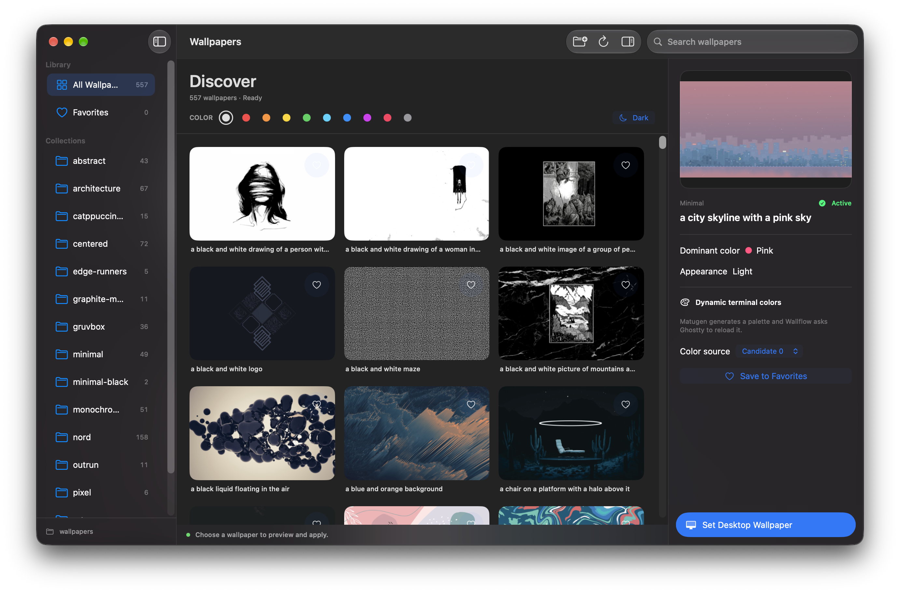

# Wallflow Rice

The ricing edition of Wallflow. Browse and apply wallpapers with the native macOS gallery, then generate a matching Matugen palette and reload Ghostty.

**Matugen and Ghostty are required for this edition.** Wallflow Rice reports setup errors instead of treating a missing dependency as an optional feature.

## Requirements

- macOS 14 or later
- Ghostty installed and discoverable by macOS
- Matugen installed and configured with a Ghostty template
- Swift compiler from Xcode or Apple Command Line Tools for source builds
- A user-selected folder of wallpapers
- Accessibility permission for the current local developer build when it asks Ghostty to reload

## Local build

```sh
./Scripts/build-app.sh
open "dist/Wallflow Rice.app"
```

Or install as a separate application without overwriting an existing Wallflow installation:

```sh
./Scripts/install-local.sh
```

See [Rice setup](Docs/RICE_SETUP.md) before using the palette feature. On a Mac without a wallpaper folder, choose one in Wallflow Rice.

## Two maintained editions

- `main`: Wallflow Core. Independent wallpaper manager without Ghostty or Matugen.
- `rice`: Wallflow Rice. Actively maintained wallpaper manager with required Ghostty and Matugen.

Both branches receive fixes and releases. Rice is not a legacy branch. The editions use different application names and bundle IDs so users can install both.

## Known issue

The Ghostty reload path currently uses macOS Accessibility to open the Ghostty application menu. It works locally but briefly displays the menu. This is tracked as a bug and is not suitable for a polished public release. Do not claim silent reloads or permission-free operation until implemented and tested.

## License

A public distribution license has not been chosen yet. Do not publish binary releases until licensing and icon provenance are checked.

## Developer verification

Before pushing commits, run:

```sh
./Scripts/verify-repo.sh
./Scripts/build-app.sh --replace
```

The second command replaces only this branch's ignored `dist` build after making a backup. See [development notes](Docs/DEVELOPMENT.md), [GitHub workflow](Docs/GITHUB_WORKFLOW.md) and [release checklist](Docs/RELEASE_CHECKLIST.md).

## Screenshot


