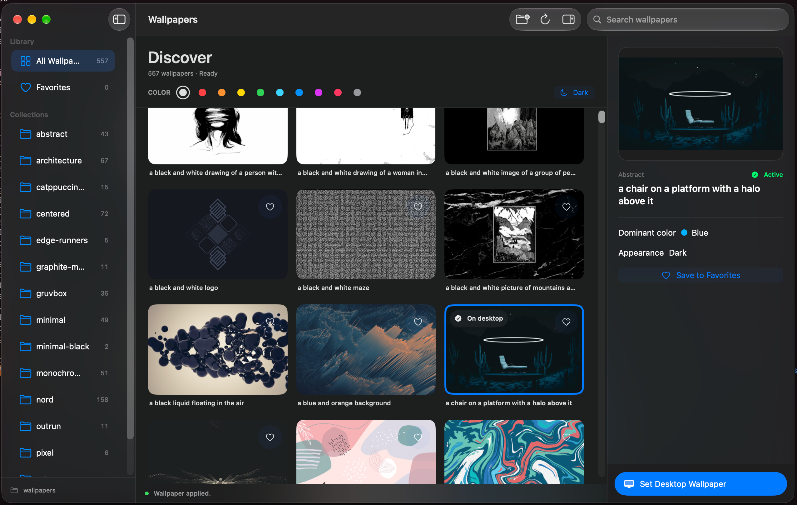

<div align="center">
  
  <h1>Wallflow</h1>
  <p><strong>A better home for your wallpapers.</strong></p>
  <p>Browse, organize, and apply your local wallpaper collection in a native macOS app.</p>
  <p>
    <a href="https://github.com/UltraBot05/wallflow/releases"><strong>Releases</strong></a>
    &nbsp;&middot;&nbsp;
    <a href="https://github.com/UltraBot05/wallflow/tree/rice">Wallflow Rice</a>
    &nbsp;&middot;&nbsp;
    <a href="https://github.com/UltraBot05/wallflow/issues">Report an issue</a>
  </p>
  <p>
    
    &nbsp; Swift + SwiftUI &nbsp; | &nbsp; macOS 14+
  </p>
</div>



<sub>Wallflow Core on macOS. Screenshot from a development build.</sub>

## Why Wallflow?

Your wallpaper collection should be easy to browse, not buried in Finder windows. Wallflow turns a folder of images into a searchable library with previews and quick desktop application.

- **Bring your own library.** Select a folder of images. Subfolders appear as collections.
- **Find the right wallpaper.** Search names, filter by color or dark appearance, and browse image previews.
- **Keep favorites handy.** Save frequently used wallpapers without moving the originals.
- **Apply in a click.** Set a wallpaper across connected displays using native macOS APIs.
- **Feel at home on macOS.** A SwiftUI gallery, sidebar, and inspector that follow the system interface.

No account, Ghostty, Matugen, FloatPane, Homebrew, or preloaded image collection is required to use Core.

## Pick your edition

| | **Core** (`main`) | **Rice** (`rice`) |
| --- | --- | --- |
| Local library, search, filters, favorites | Yes | Yes |
| Native wallpaper application | Yes | Yes |
| Ghostty and Matugen required | No | Yes |
| Wallpaper-driven Ghostty colors | No | Yes |
| Development and maintenance | Active | Active |

**[See Wallflow Rice](https://github.com/UltraBot05/wallflow/tree/rice)** if you want wallpaper-driven terminal colors. Both editions are maintained and can be installed side by side.

## Download and install

**[View GitHub Releases](https://github.com/UltraBot05/wallflow/releases)**

Signed, downloadable builds are being prepared. The Releases page is the download location when the first build is published. Until then, build locally with Apple's Swift toolchain:

```sh
git clone https://github.com/UltraBot05/wallflow.git
cd wallflow
git switch main
./Scripts/verify-repo.sh
./Scripts/build-app.sh
open "dist/Wallflow Core.app"
```

Requires macOS 14 or newer and Xcode or Apple Command Line Tools **for source builds only**. The future app download will not require users to install a compiler.

## First run

1. Open Wallflow Core.
2. Choose a folder of wallpapers.
3. Select an image to preview it, filter the gallery, or mark it as a favorite.
4. Click **Set Desktop Wallpaper**.

Wallflow reads your existing files in place. It does not import your images into the Git repository.

## Privacy and development

Core does not require Accessibility permission or terminal integration to browse and apply wallpapers. Local preferences and the library index remain on your Mac.

This project is in active development. Both editions build in GitHub Actions, but compilation is not the same as testing or notarizing a downloadable release.

- [Development notes](Docs/DEVELOPMENT.md)
- [Privacy notes](Docs/PRIVACY.md)
- [Issue tracker](https://github.com/UltraBot05/wallflow/issues)
- [Release preparation](Docs/RELEASE_GUIDE.md)

**License:** [MIT](LICENSE)..
